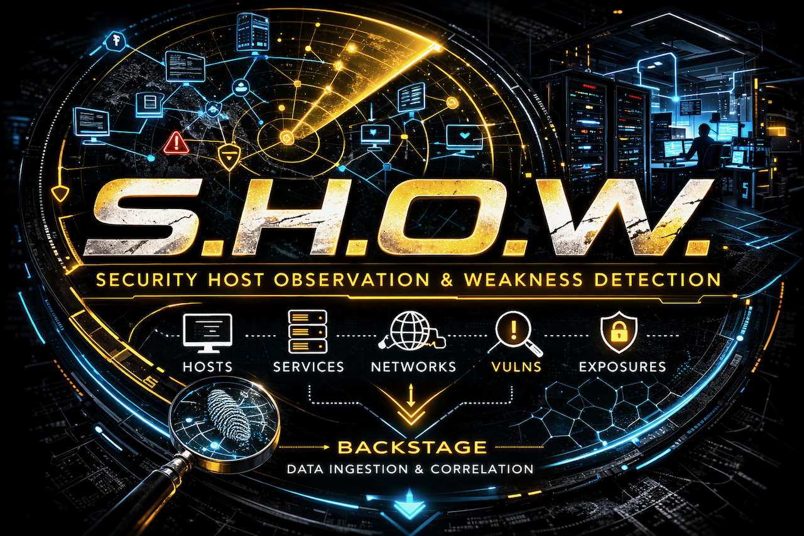

# SHOW

**S**ecurity **H**ost **O**bservation & **W**eakness Detection

A containerized internal network reconnaissance and vulnerability assessment platform designed for rapid discovery and security validation of on-premise infrastructure.



---

## Overview

SHOW automates the discovery and assessment of internal network assets through a coordinated pipeline of network scanning and security assessment tools. It's designed for security teams, IT administrators, and penetration testers who need fast, reliable visibility into internal attack surfaces.

### What SHOW Does

```
subnets → masscan (fast sweep) → nmap (service detection) → httpx (web services)
        → nuclei (vulnerabilities) → testssl (TLS) → gowitness (screenshots)
        → normalized sensor-output streams (hosts / services / web_assets / tls / findings)
```

**Key Capabilities:**
- ⚡ Ultra-fast network discovery (Layer 2/3)
- 🔍 High-speed port scanning (10,000+ pps)
- 🌐 Service fingerprinting and version detection
- 🌍 HTTP/HTTPS service profiling
- 🎯 Template-based vulnerability scanning
- 🔒 TLS/SSL configuration assessment
- 📸 Visual reconnaissance (screenshots)
- 🛡️ Authenticated deep vulnerability assessment → separate **EXPOSE** module (SHOW is unauthenticated-only)
- 📊 Structured outputs (JSON, CSV, NDJSON)

---

## Quick Start

### Prerequisites
- **Linux host** (native) — SHOW runs its tools in `network_mode: host` for raw packets and local-segment discovery. On macOS/Windows use a Linux VM with bridged networking (Docker Desktop's "host" is its own VM, not your LAN).
- Docker Engine (rootful) & Docker Compose
- `yq` (YAML processor) - [Installation guide](https://github.com/mikefarah/yq)
- `jq` (JSON processor) - Usually pre-installed on Linux/macOS
- Permission to use Docker — membership in the `docker` group, or prefix commands with `sudo`. SHOW needs
  no other root access: the raw-packet capabilities (`NET_RAW` / `NET_ADMIN`) are granted to the scanning
  containers by `docker-compose.show.yml`.

### Installation

```bash
# Clone the repository
git clone https://github.com/jonathanristo/SHOW.git
cd SHOW

# Add targets — IP, CIDR (any size), or hostname, one per line
cp data/in/subnets.txt.example data/in/subnets.txt
cat > data/in/subnets.txt <<EOF
10.0.1.50
192.168.1.0/24
10.0.0.0/16
EOF

# First-time setup: builds the discovery image + downloads Nuclei templates
./showctl setup

# Run your first scan
./showctl run daily
```

### First Run
```bash
# Daily scan (fast, high/critical findings only)
./showctl run daily

# Results will be in:
./data/out/[timestamp]/
```

**Note:** masscan and nmap craft raw packets; the containers get those capabilities from the compose file, so
your shell only needs Docker access. Running SHOW with `sudo` works too, but leaves `data/out/` owned by root.

Set `SHOW_AUTHORIZED_BY` to record who authorized the scan in `run_manifest.json` (it reads `UNATTESTED`
otherwise):

```bash
SHOW_AUTHORIZED_BY="J. Doe / CHG-1234" ./showctl run daily
```

---

## Usage

### Basic Commands

```bash
# First-time setup (discovery image + Nuclei templates)
./showctl setup

# Validate show.yaml (types / enums / port specs) without scanning
./showctl config-check

# Discovery only (masscan → arp/nbt → nmap → httpx); exits non-zero if a primary tool failed
./showctl discover

# Daily workflow (recommended for routine scanning)
./showctl run daily

# Weekly workflow (deeper: full ports, medium severity)
./showctl run weekly

# Re-merge/normalize an existing run's outputs (latest run, or a given dir)
./showctl merge [data/out/<timestamp>]
```

### What Each Profile Does

#### Daily Profile (`run daily`)
- **Duration:** ~10-30 minutes
- **Scope:** Fast discovery + high/critical vulnerabilities
- **Tools:** masscan (+ arp-scan / nbtscan enrichment) → nmap → httpx → nuclei (high/crit) → testssl → gowitness → merge

#### Weekly Profile (`run weekly`)
- **Duration:** ~30-90 minutes
- **Scope:** Everything in daily, deeper
- **Tools:** daily + full-port masscan + medium-severity nuclei

> Authenticated deep vulnerability assessment (OpenVAS/Greenbone) is **not** part of SHOW — it lives in the separate **EXPOSE** module. SHOW is unauthenticated-only.

---

## Configuration

**`show.yaml` is the single source of truth for tuning SHOW — every knob is documented inline, right
next to its value.** This section is the narrative overview; open `show.yaml` for the full annotated
list.

```yaml
inputs:
  targets_file: "./data/in/subnets.txt"   # IP / CIDR (any size) / hostname, one per line
  hosts_file:   "./data/in/hosts.txt"     # optional, unioned with targets_file

scan:
  masscan:
    rate: 10000            # packets/sec (~10 Mbps). 5000 conservative · 50000 aggressive
    ports: "1-1024,3306,3389,5432,8080,..."   # explicit TCP port spec (masscan has no "top-N")
    full_ports: "0-65535"  # used by `run weekly` only
    exclude_private: false # true = skip the RFC 1918 ranges
  arp_scan:  { enable: true }    # local-segment MAC enrichment (best-effort)
  nbtscan:   { enable: true }    # NetBIOS name enrichment (best-effort)
  nmap:
    timing: "T4"                 # T0 (paranoid) … T5 (insane)
    version_intensity: "light"   # light | full
  httpx:    { rate_limit: 400 }  # requests/sec
  nuclei:
    severity_daily:  "high,critical"
    severity_weekly: "medium,high,critical"
    rate_limit: 200
    concurrency: 50
  tls:      { testssl: true }

screenshots:
  enable: true
  gowitness: { workers: 10, delay: 0 }

output:
  root: "./data/out"
```

> **TCP-only.** SHOW's chain (nmap `-sV`, httpx, testssl, gowitness) probes TCP/web services, so masscan
> port specs must be TCP — `config-check` rejects UDP (`U:`) specs. UDP / authenticated depth belongs to EXPOSE.

### Common scenarios

**Conservative** (fragile / IDS-monitored network):
```yaml
scan: { masscan: { rate: 5000 }, nmap: { timing: "T2" } }
```

**Aggressive** (fast, loud — lab or maintenance window):
```yaml
scan: { masscan: { rate: 50000 }, nmap: { timing: "T5" } }
```

**Single host or a /16** — no config change: just put the IP or CIDR in `data/in/subnets.txt`;
masscan expands CIDRs of any size.

**Authenticated vulnerability assessment** (credentials *into* hosts) is **not** part of SHOW — it
lives in the separate **EXPOSE** module. SHOW stays unauthenticated.

---

## Output Structure

```
data/out/20260125T143022Z/      # one dir per run, UTC timestamp (YYYYMMDDTHHMMSSZ)
├── in_ips.txt / in_cidrs.txt / in_hosts.txt   # Targets split by type
├── host_context.tsv           # hostname → resolved IP(s), feeds the record envelope
├── targets_all.txt            # Classified + resolved scan targets
├── masscan.list               # Raw masscan output (open host:port)
├── hosts_ports.txt            # Discovered host:port
├── hosts_alive.txt            # Live hosts (+ hosts_alive_v4.txt / hosts_alive_v6.txt)
├── arp.tsv                    # ip → MAC (local segment, if arp-scan enabled)
├── nbt.tsv                    # ip → NetBIOS name (if nbtscan enabled)
├── nmap.xml / nmap.gnmap      # IPv4 service fingerprints (XML parsed for services + OS)
├── nmap6.xml / nmap6.gnmap    # IPv6 pass (only if IPv6 hosts were found)
├── urls.txt                   # http:// + https:// candidates for every open port (httpx input)
├── httpx.json                 # HTTP service details (raw)
├── live_urls.txt              # URLs httpx confirmed live (nuclei input)
├── https_urls.txt             # Live HTTPS URLs (testssl input)
├── shot_urls.txt              # Live URLs (gowitness input)
├── nuclei.jsonl               # Vulnerability findings (raw)
├── testssl.json               # TLS/SSL assessment (raw)
├── screenshots/               # Screenshot images
├── gowitness.jsonl            # Screenshot manifest (stateless)
├── run_manifest.json          # Run metadata: operator, authorized_by, targets, duration, streams, status
│
│   # ── Normalized sensor-output/1.0 streams — the BACKSTAGE contract ──
├── hosts.ndjson               # Hosts (+ mac / netbios / os)
├── services.ndjson            # Open services (service/product/version/cpe)
├── web_assets.ndjson          # HTTP(S) endpoints
├── tls.ndjson                 # TLS certificates (fingerprint_sha256 anchor)  (if testssl ran)
├── findings.ndjson            # Normalized vulns (nuclei + testssl)
│
└── *.csv                      # hosts / open_ports / web_assets / tls / findings_summary (human exports)
```

### Run status

`run_manifest.json` carries a `status` so a downstream consumer never mistakes a broken scan for a clean one:

- **`ok`** — every tool ran and normalization completed.
- **`degraded`** — the scan finished and emitted partial data, but a primary tool failed to run or produced
  malformed output; the offending tools are listed in `degraded_tools[]`. A failed tool is never silently
  reported as an empty "clean" result.
- **`normalize_failed`** — the normalizer did not complete; `run daily` / `run weekly` also exit non-zero.

Standalone `./showctl discover` writes no manifest, so it signals a degraded run via a **non-zero exit code** instead.

---

## Tool Stack

SHOW leverages battle-tested network and security tools:

| Phase | Tool | Purpose |
|-------|------|---------|
| **Discovery** | [masscan](https://github.com/robertdavidgraham/masscan) | Ultra-fast port scanning |
| | [arp-scan](https://github.com/royhills/arp-scan) | Layer 2 host discovery |
| | [nbtscan](http://www.unixwiz.net/tools/nbtscan.html) | NetBIOS/Windows name resolution |
| **Fingerprinting** | [nmap](https://nmap.org/) | Service & OS detection (`-sV -O`) |
| | [httpx](https://github.com/projectdiscovery/httpx) | HTTP probing & tech detection |
| **Assessment** | [nuclei](https://github.com/projectdiscovery/nuclei) | Template-based vulnerability scanning |
| | [testssl.sh](https://testssl.sh/) | TLS/SSL security assessment |
| **Recon** | [gowitness](https://github.com/sensepost/gowitness) | Screenshot capture & reporting |

---

## Architecture

```
┌─────────────────────────────────────────────────────────────┐
│                     showctl (Bash)                          │
│           Network Scanning Orchestration Engine             │
└─────────────────────────────────────────────────────────────┘
                            │
                ┌───────────┼───────────┐
                │           │           │
        ┌───────▼──┐   ┌────▼────┐  ┌──▼──────┐
        │ masscan  │   │ arp-scan│  │ nbtscan │
        │ (ports)  │   │  (L2)   │  │(NetBIOS)│
        └───────┬──┘   └────┬────┘  └──┬──────┘
                │           │           │
                └───────────┼───────────┘
                            │
                    ┌───────▼────────┐
                    │      nmap      │
                    │  (services)    │
                    └───────┬────────┘
                            │
                    ┌───────▼────────┐
                    │     httpx      │
                    │  (HTTP probe)  │
                    └───────┬────────┘
                            │
                ┌───────────┼───────────┐
                │           │           │
        ┌───────▼──┐   ┌────▼────┐  ┌──▼──────┐
        │  nuclei  │   │testssl  │  │gowitness│
        │  (vulns) │   │  (TLS)  │  │(screens)│
        └───────┬──┘   └────┬────┘  └──┬──────┘
                │           │           │
                └───────────┼───────────┘
                            │
              ┌───────────▼───────────┐
              │   normalize + merge   │
              │  sensor-output NDJSON │
              │       + CSV           │
              └───────────────────────┘
```

**Design Principles:**
- **Speed-first** - Masscan can scan entire Class B in seconds
- **Containerized** - All tools isolated, easy deployment
- **Timestamped** - Historical tracking built-in
- **Network-aware** - Runs in host network mode for raw packet access
- **Fail-safe** - Tool failures don't break the pipeline
- **Re-runnable** - `discover` runs on its own, and `merge` re-normalizes any existing run

---

## Use Cases

### Internal Security Assessment
```bash
# Quarterly internal vulnerability scan
./showctl run weekly
# Review findings in data/out/[timestamp]/findings_summary.csv
```

### Network Inventory & Asset Discovery
```bash
# Discover what's actually on your network
./showctl run daily
# Import nmap.xml into your CMDB
```

### Breach & Attack Simulation (BAS)
```bash
# Simulate attacker reconnaissance post-compromise
./showctl run daily
# Identify lateral movement paths
```

### Continuous Security Monitoring
```bash
# crontab of a user in the docker group. cron's default PATH lacks /usr/local/bin (where yq usually lives).
PATH=/usr/local/bin:/usr/bin:/bin
SHOW_AUTHORIZED_BY="Security team / standing approval"

# Daily cron job for change detection
0 2 * * * cd /path/to/show && ./showctl run daily

# Weekly sweep (full ports, medium severity)
0 3 * * 0 cd /path/to/show && ./showctl run weekly
```

### Penetration Testing
```bash
# Initial foothold → network mapping
./showctl run daily
# Feed results into exploitation frameworks
```

### Compliance Scanning
```bash
# PCI DSS quarterly scans
./showctl run weekly
# Generate reports from findings_summary.csv
```

---

## Performance Tuning

### Masscan Rate Limiting

**Default:** 10,000 packets/second

```yaml
scan:
  masscan:
    rate: 5000   # Conservative (avoid triggering IDS)
    rate: 10000  # Balanced (default)
    rate: 50000  # Aggressive (use with caution)
```

**Network impact:**
- 5,000 pps = ~5 Mbps
- 10,000 pps = ~10 Mbps  
- 50,000 pps = ~50 Mbps

### Nmap Timing

```yaml
scan:
  nmap:
    timing: T2  # Polite (slower, stealthier)
    timing: T3  # Normal
    timing: T4  # Aggressive (default)
    timing: T5  # Insane (very loud, very fast)
```

### Scope Management

**Scan specific ports only:**
```yaml
scan:
  masscan:
    ports: "80,443,22,3389,445,3306,5432"
```

**Full port scan (weekly sweep):**
```yaml
scan:
  masscan:
    full_ports: "0-65535"  # all 65,535 ports; used by `run weekly`
```

---

## Data Formats

### NDJSON (Machine-Readable)

```bash
# Find all critical vulnerabilities
jq 'select(.severity=="critical")' data/out/*/findings.ndjson

# List web services by technology (tech is a list of {name, version, category, confidence})
jq 'select(any(.tech[]?; .name|test("apache";"i")))' data/out/*/web_assets.ndjson

# Count services by port
jq -r 'select(.message|not) | .port' data/out/*/services.ndjson | sort | uniq -c | sort -rn

# Extract all IPs with port 445 open (SMB)
jq -r 'select(.port==445) | .ip_at_observation_time' data/out/*/services.ndjson
```

A stream with no records holds a single placeholder line that carries only a `message` field;
`select(.message|not)` skips it.

### CSV (Analysis-Ready)

Import into Excel, Splunk, or any analysis tool:

```
findings_summary.csv    - Vulnerability summary
web_assets.csv          - HTTP/HTTPS services
open_ports.csv          - Open services (ip, port, protocol, service, product, version)
hosts.csv               - Hosts (ip, mac, netbios, os, is_private)
tls.csv                 - TLS certificates
hosts_ports.txt         - Simple host:port list
```

---

## Advanced Usage

### Scanning Multiple Subnets

```bash
# data/in/subnets.txt
10.0.0.0/8
172.16.0.0/12
192.168.0.0/16
```

### Excluding Hosts

To skip all RFC 1918 ranges (10/8, 172.16/12, 192.168/16), set `scan.masscan.exclude_private: true` in
`show.yaml`.

SHOW has no setting for excluding individual hosts. The simplest way is to leave them out of
`data/in/subnets.txt` by listing the remaining ranges. Otherwise, add masscan's `--excludefile` to the
masscan call in `showctl`'s `discover()`. masscan runs in the `discovery` container, which mounts `./data`
at `/data`:

```bash
cat > data/in/exclude.txt <<EOF
10.0.1.1
10.0.1.254
EOF

# in showctl discover(), add to the masscan arguments:
#   --excludefile /data/in/exclude.txt
```

### Authenticated Nmap Scanning

For quick Windows enumeration you can add NSE scripts to the nmap step. Note that credentials passed
as `--script-args` are visible in the process list (`ps`) — for real authenticated assessment use the
separate **EXPOSE** module, not SHOW.

```bash
# Illustrative — add to the nmap command in showctl
compose run --rm nmap nmap \
  --script smb-enum-shares,smb-enum-users \
  --script-args smbusername=scanner,smbpassword='***' \
  -iL /data/out/$TS/hosts_alive.txt
```

### Authenticated / deep vulnerability assessment → EXPOSE

SHOW is **unauthenticated-only** and runs no deep vulnerability scanner. Authenticated, credentialed
deep assessment (OpenVAS/Greenbone or another engine) lives in the separate **EXPOSE** module, which
consumes SHOW's discovered host list and emits findings in the same sensor-output contract. See the
EXPOSE technical reference.

---

## Network Requirements

### Firewall Rules

SHOW needs to send and receive traffic on:
- **TCP, every port in the masscan spec** - masscan SYN sweep, then nmap / httpx / nuclei / testssl / gowitness
  against the ports it found open (`run weekly` sweeps all 65,535)
- **UDP 137** - nbtscan NetBIOS name queries (if enabled)
- **ARP, local segment only** - arp-scan MAC enrichment (if enabled)

SHOW does no ICMP host discovery: masscan finds hosts by their open ports, and nmap runs with `-Pn`.

### Recommended Deployment

**Option 1: Scanning Appliance**
- Dedicated VM/physical host
- Bridge or promiscuous mode networking
- Access to all VLANs you want to scan

**Option 2: Jump Box**
- Deploy on existing admin/security segment
- Ensure routing to target networks
- May need firewall exceptions

**Option 3: Cloud/Hybrid**
- VPN into target network
- Be aware of bandwidth costs
- Consider rate limiting

---

## Comparison to Alternatives

| Feature | SHOW | Nessus | OpenVAS | Rapid7 | Nmap Alone |
|---------|------|--------|---------|--------|------------|
| **Cost** | Free | $$$$ | Free | $$$$ | Free |
| **Setup** | < 5 min | ~30 min | ~1 hour | Cloud/days | < 1 min |
| **Speed** | Very Fast | Medium | Slow | Medium | Fast |
| **Automation** | Full | Partial | Manual | Full | Manual/scripted |
| **Visual Recon** | ✓ | ✗ | ✗ | ✗ | ✗ |
| **Vulnerability DB** | Templates | Commercial | Free | Commercial | NSE scripts |
| **Reporting** | CSV/JSON | PDF/HTML | PDF | Dashboard | Text/XML |
| **Learning Curve** | Low | Medium | High | Medium | Low |
| **Enterprise Support** | Community | ✓ | ✗ | ✓ | Community |

---

## Troubleshooting

### "permission denied … docker.sock"
Your user can't reach the Docker daemon. Add it to the `docker` group (then log out and back in), or run
with `sudo`:
```bash
sudo usermod -aG docker "$USER"
```

### "Operation not permitted" during masscan
The compose file already grants the scanning containers `NET_RAW` / `NET_ADMIN`. This error usually means
those capabilities can't take effect: rootless Docker, or a Docker host that isn't native Linux (Docker
Desktop). Use rootful Docker Engine on a Linux host or VM.

### masscan can't pick an interface
```bash
# Force the interface via env (no code edit needed); also used by arp-scan
SHOW_IFACE=eth0 ./showctl run daily
# with sudo, keep the variable: sudo SHOW_IFACE=eth0 ./showctl run daily
```

### Masscan finds nothing
```bash
# Test manually (masscan lives in the 'discovery' service)
docker compose -f docker-compose.show.yml run --rm discovery \
  masscan -p80,443,22 192.168.1.0/24

# Check if you can reach targets
ping 192.168.1.1
```

### Nmap very slow
```bash
# Adjust timing in show.yaml
scan:
  nmap:
    timing: T5  # Faster but noisier
```

### Missing yq or jq
```bash
# Install yq
wget https://github.com/mikefarah/yq/releases/latest/download/yq_linux_amd64 \
  -O /usr/local/bin/yq && chmod +x /usr/local/bin/yq

# jq usually available via package manager
sudo apt install jq  # Debian/Ubuntu
sudo yum install jq  # RHEL/CentOS
brew install jq      # macOS
```

---

## Security Considerations

### Legal & Ethical Use

⚠️ **WARNING:** Network scanning can be disruptive and may be illegal without authorization.

- **Only scan networks you own or have explicit written permission to test**
- Obtain approval from IT/Security teams
- Coordinate with network operations to avoid triggering IDS/IPS
- Consider impact on production systems
- Follow your organization's security policies

### Rate Limiting

High-speed scanning can:
- Saturate network links
- Trigger IDS/IPS alerts
- Crash legacy devices (printers, IoT)
- Impact application performance

**Start conservative, increase carefully.**

### Data Handling

Scan results may contain:
- Sensitive host information
- Vulnerability details
- Service banners with version info
- Screenshots of internal applications

**Store securely, restrict access, encrypt at rest.**

---

## Roadmap

- [x] Core network discovery pipeline
- [x] Vulnerability scanning integration
- [x] Visual reconnaissance (screenshots)
- [x] Structured data outputs (JSON/CSV) — sensor-output/1.0 conformant
- [x] Authenticated deep assessment split out to the EXPOSE module
- [x] Layered test suite (static · parser · golden · contract · integration)
- [ ] Web UI for viewing results
- [ ] Differential scanning (detect changes over time)
- [ ] Report generation (PDF/HTML)
- [ ] Slack/email notifications
- [ ] Integration with ticketing systems (Jira, ServiceNow)
- [ ] Active Directory enumeration tools
- [ ] Kubernetes deployment manifests
- [ ] Multi-site orchestration

---

## Testing

SHOW ships with a layered test suite under [`tests/`](tests/) — bash-only, no external test framework.
Run it with:

```bash
tests/run.sh                        # layers 1–4 (integration is opt-in)
tests/run.sh 20                     # only the layer(s) whose name contains '20'
SHOW_INTEGRATION=1 tests/run.sh 50  # + real-container integration (needs Docker)
```

Exit code is non-zero if any layer fails.

| Layer | File | What it proves | Docker |
|-------|------|----------------|--------|
| 1 | `10_static.sh` | `bash -n` / `py_compile` / shellcheck, plus grep-guards that lock in each regression below | config check only |
| 2 | `20_parsers.sh` | Sources `showctl`'s **real** `sh_*` transforms + `config_check` / `latest_run` / `manifest`, then runs the `normalize.py` units | no |
| 3 | `30_golden.sh` | `normalize.py` over recorded tool output matches `tests/golden/` byte-for-byte | no (host `python3`) |
| 4 | `40_contracts.sh` | The container images accept the exact flags `showctl` passes them (catches upstream image drift) | yes |
| 5 | `50_integration.sh` | The real `showctl merge` path — crun wrapper + normalize + scan_id derivation — over recorded output (opt-in) | yes |

The static and parser layers lock in the specific fixes the reviews surfaced, including:

- **Orchestration** — crun runs `-T </dev/null` and always names a service; nmap uses `-Pn` + a dedicated `-6` pass; nuclei scans `live_urls.txt`, never the raw sweep; IPv6 host:port is bracketed; `SHOW_TEST_MODE` keeps sourcing side-effect-free.
- **Run selection** — `latest_run` picks the newest **non-empty** dir by name (never by mtime); `merge` drops the empty startup dir first and derives `scan_id` from the run-dir timestamp.
- **Degraded runs** — a primary-tool failure or malformed tool output (bad JSONL, non-object rows, corrupt nmap XML, unusable `testssl.json`) is recorded as `status:"degraded"` + `degraded_tools[]` and never read as a clean empty scan; `discover` / `merge` signal it via exit code; the `.normalize_degraded` sidecar clears on a clean re-run.
- **Input hygiene** — URL lists require a host and reject junk (`^https?://…\S*$`); the observed IP is derived safely (`host_from_httpx`, never carrying a port); IPv6 is bracketed in the TLS `matched_at`; nmap emits open ports only; screenshot paths are normalized.
- **Config & images** — `config_check` validates every tunable knob (rates, timing, `version_intensity`, nuclei severity tokens, TCP-only port specs) with no dead `show.yaml` knob; amd64 images are platform-pinned.

Fixtures under `tests/fixtures/` use synthetic hosts only (RFC 1918 / RFC 3849 ranges); regenerate the
golden baselines with `tests/regen_golden.sh` after an intentional `normalize.py` change, then review the diff.
See [`tests/README.md`](tests/README.md) for details.

> Run the suite with `bash`, not `sh`/`zsh` — `showctl` is bash and the suite sources it for its functions.

---

## Contributing

Contributions welcome! Areas where we'd love help:

- IPv6 live-network validation
- Report generation templates
- Additional tool integrations (BloodHound, CrackMapExec)
- Performance optimization
- Documentation improvements

**To contribute:**
1. Fork the repository
2. Create a feature branch (`git checkout -b feature/awesome-feature`)
3. Make your change and run the test suite (`tests/run.sh`) — add or update tests under `tests/`
4. Commit your changes (`git commit -m 'Add awesome feature'`)
5. Push to the branch (`git push origin feature/awesome-feature`)
6. Open a Pull Request

---

## FAQ

**Q: Does SHOW need sudo/root?**  
A: Only for Docker access. masscan and nmap need raw sockets (CAP_NET_RAW), and `docker-compose.show.yml`
grants that to their containers. A user in the `docker` group can run SHOW without `sudo`.

**Q: Can I run this on Windows?**  
A: Use a Linux VM with a bridged network adapter. Docker Desktop (including its WSL2 backend) runs
containers in its own VM, so `network_mode: host` doesn't put the scanners on your LAN. Under WSL2's default
NAT networking, arp-scan can't see your local segment either.

**Q: How is this different from STRIP?**  
A: STRIP = external/internet reconnaissance. SHOW = internal/network reconnaissance. They complement each other.

**Q: Does SHOW generate reports?**  
A: Currently outputs CSV/JSON/NDJSON. HTML/PDF report generation is on the roadmap. You can import CSV into Excel/BI tools.

**Q: Can I run daily/weekly simultaneously?**  
A: Not recommended. They'll create separate timestamped outputs but may compete for network resources.

**Q: How do I scan through a VPN?**  
A: SHOW works over VPN. Just ensure your VPN routes to target subnets and allows raw packets.

**Q: What about IPv6?**  
A: Handled through the scan chain — IPv6 addresses/CIDRs are swept by masscan, bracketed in `host:port` and URLs, given a separate `nmap -6` pass (`nmap6.xml`), and hostnames resolve both A and AAAA. Fixture-verified, but **not yet exercised against a live IPv6 network** — confirm in your environment before relying on it.

**Q: Where did authenticated / deep vulnerability scanning go?**  
A: SHOW is unauthenticated-only. Authenticated, credentialed deep assessment (OpenVAS/Greenbone) is a separate module, **EXPOSE**, which consumes SHOW's host list and emits findings in the same sensor-output contract.

---

## License

MIT License - see [LICENSE](LICENSE) file for details.

---

## Acknowledgments

SHOW stands on the shoulders of giants. Huge thanks to:

- [Robert David Graham](https://github.com/robertdavidgraham) - masscan
- [Gordon Lyon (Fyodor)](https://nmap.org/) - nmap
- [ProjectDiscovery](https://github.com/projectdiscovery) - httpx, nuclei
- [testssl.sh team](https://github.com/drwetter/testssl.sh) - TLS testing
- [gowitness](https://github.com/sensepost/gowitness) - Screenshot tool

And the entire open-source security community.

---

## Support

- **Issues**: [GitHub Issues](https://github.com/jonathanristo/show/issues)
- **Discussions**: [GitHub Discussions](https://github.com/jonathanristo/show/discussions)
- **Documentation**: [Wiki](https://github.com/jonathanristo/show/wiki)

---

## Related Projects

- **[STRIP](https://github.com/jonathanristo/strip)** - External attack surface reconnaissance (companion tool)

---

**Built for network defenders**
